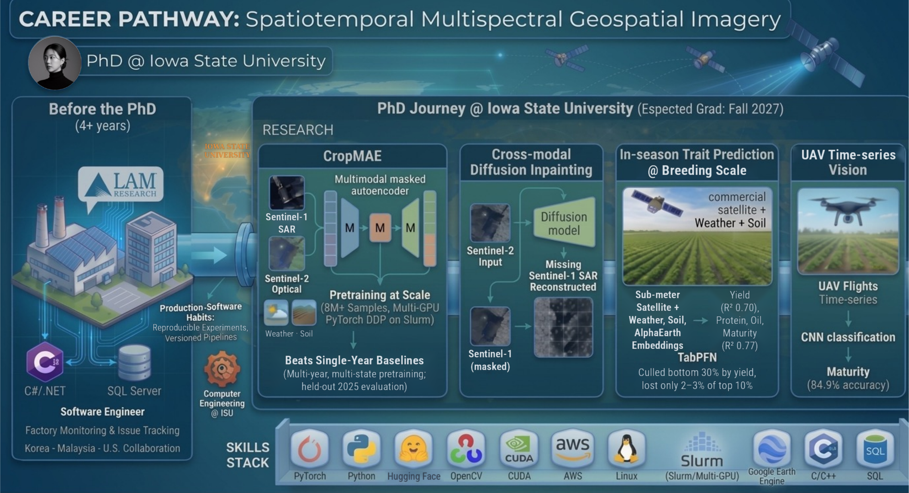

# Bitgoeul (Chloe) Kim

**PhD Student, Computer Engineering @ Iowa State University** · Computer Vision · Multimodal Foundation Models · Self-Supervised Learning

I build and adapt vision foundation models for Earth observation — pretraining multimodal masked autoencoders at scale, cross-modal generation with diffusion models, and downstream prediction from satellite and UAV imagery. Graduating Fall 2027; seeking Summer 2027 research internships in computer vision.

## Research

#### CropMAE — multimodal self-supervised pretraining
Masked autoencoder pretrained on 8M+ Earth-observation samples (Sentinel-1/2 + weather, soil, elevation; 2017–2024). Multi-GPU PyTorch DDP on Slurm; multi-year, multi-state pretraining beats single-year baselines on held-out 2025 data.

#### Cross-modal diffusion inpainting
Conditional diffusion model reconstructing missing Sentinel-1 SAR imagery from Sentinel-2 optical inputs.

#### EO foundation model adaptation (TerraMind)
Frozen vs. fine-tuned [TerraMind](https://github.com/Coooni/terramind) representations for *field-level* corn yield from Sentinel-1/2 — test R² 0.679 (MAE 12.22 bu/acre) on ~600 fields × 24 weekly bins.

#### In-season trait prediction at breeding scale
*Plot-level* prediction from sub-meter (0.3 m) commercial satellite imagery + weather, soil, and [AlphaEarth](https://deepmind.google/blog/alphaearth-foundations-helps-map-our-planet-in-unprecedented-detail/) embeddings over 56,000+ soybean breeding plots; [TabPFN](https://github.com/PriorLabs/TabPFN) predicts yield (R² 0.70), protein, oil, and maturity (R² 0.77) in-season — culling the bottom 30% of entries by predicted yield loses only 2–3% of the true top 10%. AlphaEarth prior-year embeddings add consistent gains (largest early-season), while per-image vision FM embeddings don't beat simple band statistics.

#### UAV time-series vision
CNNs on 22,043 soybean plots for maturity classification; 84.9% four-class accuracy, and ~same accuracy from 3 of 8 flights.

## Before the PhD

4+ years as a Software Engineer at Lam Research (semiconductor manufacturing) — built C#/.NET applications and SQL Server databases for factory monitoring and issue tracking, collaborating with teams across Korea, Malaysia, and the U.S. I came to research with production-software habits: versioned pipelines, reproducible experiments, and code other people can run.

## Publications

- **Kim, B.**\*, Blair, S., Jubery, Z., Sarkar, S., Singh, A. (2025). Soybean maturity prediction using two-dimensional contour plots from drone-based time series imagery. *The Plant Phenome Journal*. [doi:10.1002/ppj2.70036](https://doi.org/10.1002/ppj2.70036) — \*co-first author
- Powadi, A., **Kim, B.**, et al. (2026). Geospatial Multimodal Fusion for Field-Level Yield Prediction. *Under review.*
- **Kim, B.**, et al. In-season prediction of soybean yield, protein, oil and maturity at plot level from sub-meter satellite imagery for breeding selection. *In preparation*

## Stack

Distributed training (PyTorch DDP, Slurm, multi-GPU HPC) · Google Earth Engine · C/C++ · SQL
